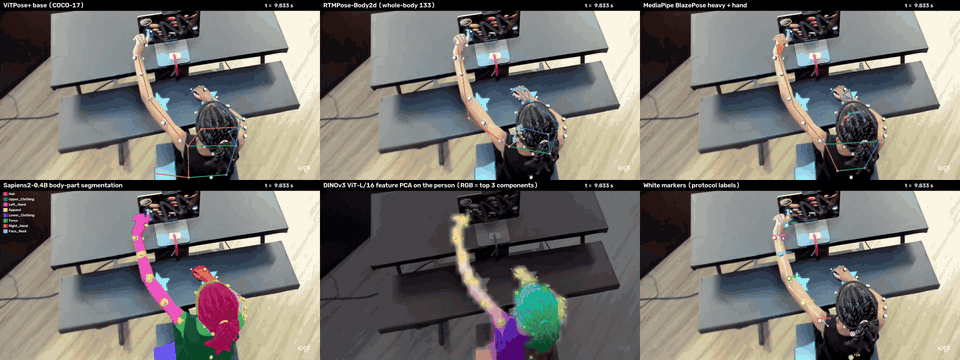
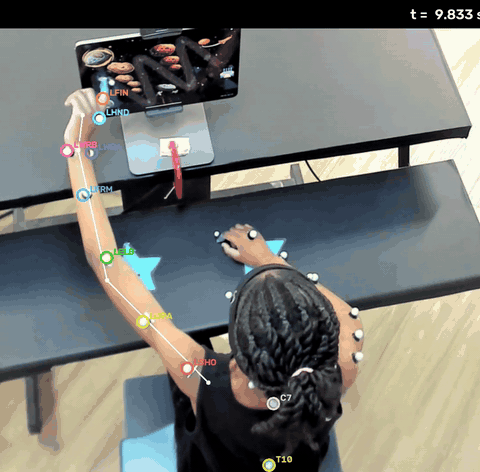

# V2K-VLMBench: Sequential vison model for upper-limb markerless movement trajectories and kinematics generation

## Research goal

Benchmark and fine-tune vision-language models (VLMs) for **sequential upper-limb kinematics**:
from video of a participant playing an iPad motor game, recover marker trajectories and
kinematic measures over time, with Vicon motion capture as the reference.

- **Benchmark.** Score pretrained vision models and VLMs against the Vicon marker trajectories and
  the kinematic features derived from them.
- **Fine-tune.** Adapt VLMs on paired video and Vicon data, so upper-limb kinematics can be
  measured from video alone.

## Demo

Visuomotor reaching gameplay in the iPad (AsteroidBelt clip, 9.8–15.4 s). The GIFs show 5.6 s at
12 fps; the linked MP4s show the whole 15 s clip.

| All six models, same frames | Tracked Plug-in Gait markers |
|:---:|:---:|
|  |  |
| [full video](docs/media/all_models_grid.mp4) | [full video](docs/media/markers_overlay.mp4) |

Left, top row: ViTPose+, RTMPose, MediaPipe. Bottom row: Sapiens2 body-part segmentation, a
DINOv3 feature PCA of the person, and the tracked markers. Pose skeletons show the participant's
left side in orange and right side in blue. Right: the arm chain LSHO → LFIN and the trunk
markers RSHO, C7, RBAK and T10. An extra outer ring marks a position that was interpolated or
filled by DINOv3 rather than detected.

## How it works

1. **Locate the limb.** ViTPose+, RTMPose and MediaPipe give left shoulder, elbow, wrist and hand
   points, which are fused by a confidence-gated median. Sapiens2 body-part segmentation adds an
   arm silhouette.
2. **Find the markers.** A white top-hat filter on min(B, G, R) picks up marker-sized white blobs,
   including motion-blurred streaks.
3. **Label and track.** Each Plug-in Gait marker starts at its expected position along the limb.
   The layout is adapted to the participant (EM), then every frame is labelled by Hungarian
   assignment. Arm markers: LSHO, LUPA, LELB, LFRM, LWRA, LWRB, LHND, LFIN. Trunk markers: RSHO,
   C7, RBAK, T10.
4. **Kinematics.** A 6 Hz Butterworth filter, movement segmentation, and per-reach features: peak
   speed, time to peak, straightness, SPARC, LDLJ, elbow/wrist/shoulder range of motion, and C7/T10
   displacement.

## Dataset

55 participants, 40 typically developing (TD) and 15 with unilateral cerebral palsy (UCP),
recorded in the PMNL lab at Marquette University while playing
[motorlearning.games](https://www.motorlearning.games/) on an iPad. Each session includes three
data streams:

| Modality | Content |
|---|---|
| iPad game trajectories | On-screen trajectories from four games: reaching, drag-and-drop, tapping, and bimanual coordination |
| Vicon motion capture | 24 markers (Plug-in Gait Upper Body placement), wall-mounted Vicon cameras |
| Video | Two views, top and side, from digital cameras |

The data are private, not included in this repository.

## Acknowledgements

Pretrained models: ViTPose / ViTPose+ (Apache-2.0), RT-DETR (Apache-2.0), RTMPose via Qualcomm
AI Hub (Apache-2.0), Google MediaPipe (Apache-2.0), Meta Sapiens2 (Sapiens2 License), and Meta
DINOv3 (DINOv3 License). Marker set: Vicon Plug-in Gait Upper Body.
